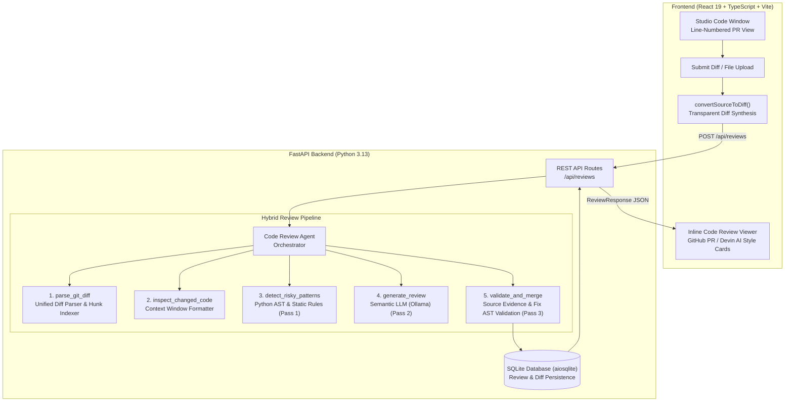

# CodeLens AI 🔍
> **Automated Code Review Agent with Deterministic AST Safety & Semantic LLM Orchestration**

[](https://fastapi.tiangolo.com)
[](https://react.dev)
[](https://www.typescriptlang.org)
[](https://vitejs.dev)
[](https://docs.pytest.org)
[](backend/benchmark.py)
[](LICENSE)

---

## 🎯 Executive Summary

**CodeLens AI** is an intelligent, developer-first automated code review platform designed to overcome the critical weaknesses of standalone linters and pure LLM reviewers:

1. **Pure Linters / Regex SAST** flag syntax errors but are blind to business logic errors, inverted arithmetic formulas, and subtle edge cases. Regex-only detectors frequently raise noisy false positives on safe parameterized queries or literal evaluations.
2. **Pure LLM Reviewers** are prone to hallucinations: inventing nonexistent file paths, reporting phantom line numbers, fabricating ZeroDivision errors on multiplication code (e.g., `total_spend * 0.125`), and suggesting syntactically broken fixes.

CodeLens AI solves this with a **Hybrid 4-Pass Architecture**:
- **PASS 1 — Deterministic Static & AST Analysis:** For Python code, a dedicated Python AST (`ast.parse`) analyzer detects SQL injection in dynamic queries, dangerous `eval`/`exec`, unsafe `pickle.loads()`, hardcoded credentials, path traversal, insecure temporary files, and unhandled collection division. Non-Python code is evaluated with context-aware static security signatures.
- **PASS 2 — Semantic LLM Analysis:** Local, private LLM execution (via Ollama, defaulting to `qwen2.5-coder:3b` or configured local models) evaluates business logic, arithmetic intent, and edge cases.
- **PASS 3 — Strict Finding Validation & Fix Verification:**
  - **Source Evidence Validation:** Every AI finding is verified against actual diff hunks. Nonexistent files, out-of-bounds line numbers, and mismatched evidence are rejected.
  - **False-Positive Elimination:** Rejects false ZeroDivision claims on code lacking division operators, rejects safe parameterized SQL queries, ignores `ast.literal_eval`, and preserves safe environment variable reads (`os.getenv`).
  - **Fix AST Validation:** Remediation snippets are validated via Python AST parsing and assigned explicit verification statuses (`validated_syntax`, `proposed`, or `rejected`).
- **PASS 4 — Devin AI / GitHub PR-Style Inline Code Review:** Line-indexed review studio displaying diff lines with inline finding cards, root cause analysis, code evidence snippets, and 1-click verified remediation copy.

> ⚡ **Offline & Partial Review Guarantee:** If Ollama is offline or unreachable, CodeLens AI continues deterministic analysis, sets `llm_available: false` and `partial_analysis: true`, and never returns an unconditional "approved" status or unverified "low" risk.

---

## 🏗️ System Architecture



---

## ⚡ Quickstart

### Prerequisites
- **Python 3.11+** (Python 3.13 recommended)
- **Node.js 18+** & npm
- *(Optional)* [Ollama](https://ollama.com/) with `qwen2.5-coder:3b` or `llama3.2` for semantic review.

### 1. Start Backend

```bash
cd backend

# Create and activate virtual environment
python3 -m venv .venv
source .venv/bin/activate       # On Windows: .venv\Scripts\activate

# Install dependencies
pip install -r requirements.txt

# Start FastAPI server
uvicorn app.main:app --port 8000 --reload
```
*Backend API will run at `http://localhost:8000` (Interactive Swagger docs: `http://localhost:8000/docs`).*

### 2. Start Frontend

```bash
cd frontend

# Install dependencies and start Vite dev server
npm install
npm run dev
```
*Frontend will run at `http://localhost:5173`.*

---

## 📊 Measured Accuracy & Benchmark Suite

CodeLens AI includes a standalone, reproducible benchmark suite (`backend/benchmark.py`) that measures Precision, Recall, F1 score, and False-Positive Rate across security vulnerabilities, logic bugs, false-positive traps, and clean code.

### Run Benchmark:

```bash
./backend/.venv/bin/python backend/benchmark.py
```

### Benchmark Results:

```
================================================================================
CODELENS AI — DETERMINISTIC & FINDING-VALIDATION BENCHMARK
================================================================================
[   TP (HIT)    ] Security     | SQLi Dynamic f-string                  (1.1ms)
[  TN (CLEAN)   ] Security     | SQL Parameterized Query (Safe)         (0.1ms)
[   TP (HIT)    ] Security     | Hardcoded API Secret                   (0.2ms)
[  TN (CLEAN)   ] Security     | Safe Environment Variable Secret       (0.1ms)
[   TP (HIT)    ] Security     | Dynamic eval() on User Input           (0.3ms)
[  TN (CLEAN)   ] Security     | Safe ast.literal_eval()                (0.1ms)
[   TP (HIT)    ] Security     | Unsafe pickle.loads() Deserialization  (0.2ms)
[   TP (HIT)    ] Logic        | ZeroDivision on Empty Collection       (0.3ms)
[  TN (CLEAN)   ] Logic        | Multiplication Decimal Cashback (Trap) (0.1ms)
[   TP (HIT)    ] Logic        | Inverted Discount Formula              (0.2ms)
[  TN (CLEAN)   ] Clean Code   | Clean Math Function                    (0.1ms)
[   TP (HIT)    ] Security     | Path Traversal in open()               (0.2ms)
--------------------------------------------------------------------------------
METRICS SUMMARY:
  Total Test Cases    : 12
  True Positives (TP) : 7
  True Negatives (TN) : 5
  False Positives (FP): 0
  False Negatives (FN): 0
  Precision           : 100.0%
  Recall              : 100.0%
  F1 Score            : 100.0%
  False Positive Rate : 0.0%
  Avg Processing Time : 0.23 ms
================================================================================
```

---

## 🧪 Comprehensive Automated Test Suite

The test suite contains **75 automated unit and regression tests** across 11 test modules:

```bash
./backend/.venv/bin/pytest backend/tests -v
```

### Test Modules:
1. `test_evidence_validation.py` (8 tests): Strict evidence verification against diff hunks, rejection of nonexistent files, out-of-bounds lines, false ZeroDivision on multiplication, safe parameterized SQL, and `ast.literal_eval`.
2. `test_fix_ast_validation.py` (5 tests): AST parsing for Python fixes, function signature verification, missing import detection (`import os`), and fix verification states (`validated_syntax`, `proposed`, `rejected`).
3. `test_diff_parser.py` & `test_diff_parser_extended.py` (10 tests): Multi-file and multi-hunk diff parsing, `\ No newline at end of file` marker safety, binary patch detection, and hunk line offset tracking.
4. `test_pattern_detector.py` (8 tests): AST and static rules for SQL injection, hardcoded credentials, unsafe eval/exec, pickle deserialization, and clean code validation.
5. `test_multilanguage.py` (5 tests): Multi-language detection for TypeScript, JavaScript, Go, Java, and C/C++.
6. `test_calculator_22_lines.py` (1 test): Complete regression testing on multi-defect calculator scenarios.
7. `test_review_validator.py` (15 tests): Semantic deduplication, severity ordering, risk escalation, and assumption sanitization.
8. `test_llm_offline_handling.py` (2 tests): Graceful degradation when Ollama is offline, partial analysis flags, and non-approved status reporting.
9. `test_api.py` & `test_api_security_extended.py` (11 tests): FastAPI endpoint validation, path traversal filename sanitization, streaming upload size limits, and safe error handling.

Frontend static analysis & production build:
```bash
npm --prefix frontend run build
```
*(Built in 267ms, 0 TypeScript errors).*

---

## ⚠️ Known Limitations & Failure Modes

1. **Semantic LLM Dependency**: When Ollama is offline, semantic analysis cannot evaluate intent or domain-specific business rules. The application explicitly flags `partial_analysis: true` and restricts findings to deterministic AST rules.
2. **Cross-Module Type Inference**: The AST analyzer evaluates the submitted diff file in context. Deep cross-module control-flow analysis (e.g. tracking a variable across 10 separate services) requires an external whole-program symbol table.
3. **Complex Dynamic Metaprogramming**: Dynamic Python constructions (`getattr(sys.modules[...], ...)` or nested `eval` chains) may require human verification or dynamic taint analysis.
4. **Non-Python Fix Validation**: Python fixes undergo strict AST syntax parsing. Fixes for TypeScript, Go, Java, and C/C++ are marked as `proposed` and validated against security and placeholder patterns, but do not invoke native external language compilers in the lightweight sandbox.

---

## 📡 REST API Reference

| Method | Endpoint | Description |
| :--- | :--- | :--- |
| `POST` | `/api/reviews` | Submit a unified diff or source file for multi-pass review |
| `POST` | `/api/reviews/upload` | Multipart file upload with chunked streaming size validation |
| `GET` | `/api/reviews` | Retrieve review history with summary metrics |
| `GET` | `/api/reviews/{id}` | Fetch full review report, persisted diff, and findings |
| `DELETE` | `/api/reviews/{id}` | Delete a review record |
| `GET` | `/api/health` | Health check and system diagnostics |

---

## 📄 License
This project is open-source under the [MIT License](LICENSE).
