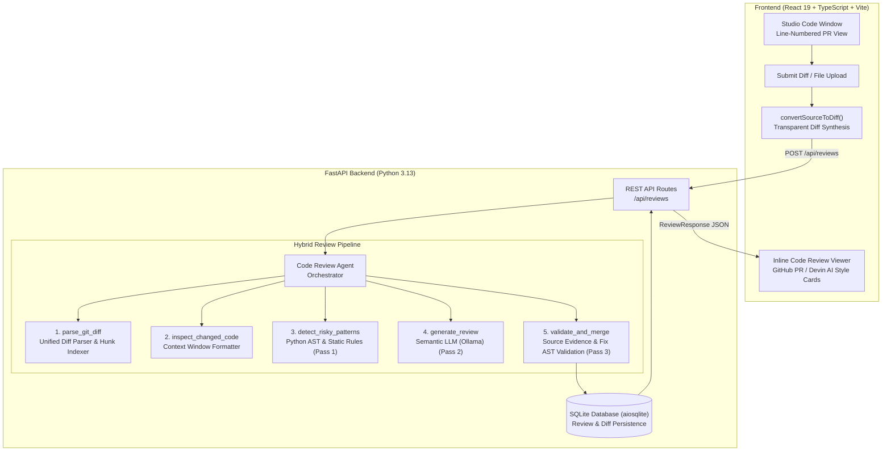

# CodeLens AI 🔍
> **Automated Code Review Agent with Deterministic AST Safety & Semantic LLM Orchestration**

[](https://fastapi.tiangolo.com)
[](https://react.dev)
[](https://www.typescriptlang.org)
[](https://vitejs.dev)
[](https://docs.pytest.org)
[](backend/benchmark.py)
[](LICENSE)

---

## 🎯 Executive Summary

**CodeLens AI** is an intelligent, developer-first automated code review platform designed to overcome the critical weaknesses of standalone linters and pure LLM reviewers:

1. **Pure Linters / Regex SAST** flag syntax errors but are blind to business logic errors, inverted arithmetic formulas, and subtle edge cases. Regex-only detectors frequently raise noisy false positives on safe parameterized queries or literal evaluations.
2. **Pure LLM Reviewers** are prone to hallucinations: inventing nonexistent file paths, reporting phantom line numbers, fabricating ZeroDivision errors on multiplication code (e.g., `total_spend * 0.125`), and suggesting syntactically broken fixes.

CodeLens AI solves this with a **Hybrid 4-Pass Architecture**:
- **PASS 1 — Deterministic Static & AST Analysis:** For Python code, a dedicated Python AST (`ast.parse`) analyzer detects SQL injection in dynamic queries, dangerous `eval`/`exec`, unsafe `pickle.loads()`, hardcoded credentials, path traversal, insecure temporary files, and unhandled collection division. Non-Python code is evaluated with context-aware static security signatures.
- **PASS 2 — Semantic LLM Analysis:** Local, private LLM execution (via Ollama, defaulting to `qwen2.5-coder:3b` or configured local models) evaluates business logic, arithmetic intent, and edge cases.
- **PASS 3 — Strict Finding Validation & Fix Verification:**
  - **Source Evidence Validation:** Every AI finding is verified against actual diff hunks. Nonexistent files, out-of-bounds line numbers, and mismatched evidence are rejected.
  - **False-Positive Elimination:** Rejects false ZeroDivision claims on code lacking division operators, rejects safe parameterized SQL queries, ignores `ast.literal_eval`, and preserves safe environment variable reads (`os.getenv`).
  - **Fix AST Validation:** Remediation snippets are validated via Python AST parsing and assigned explicit verification statuses (`validated_syntax`, `proposed`, or `rejected`).
- **PASS 4 — Devin AI / GitHub PR-Style Inline Code Review:** Line-indexed review studio displaying diff lines with inline finding cards, root cause analysis, code evidence snippets, and 1-click verified remediation copy.

> ⚡ **Offline & Partial Review Guarantee:** If Ollama is offline or unreachable, CodeLens AI continues deterministic analysis, sets `llm_available: false` and `partial_analysis: true`, and never returns an unconditional "approved" status or unverified "low" risk.

---

## 🏗️ System Architecture



---

## ⚡ Quickstart

### Prerequisites
- **Python 3.11+** (Python 3.13 recommended)
- **Node.js 18+** & npm
- *(Optional)* [Ollama](https://ollama.com/) with `qwen2.5-coder:3b` or `llama3.2` for semantic review.

### 1. Start Backend

```bash
cd backend

# Create and activate virtual environment
python3 -m venv .venv
source .venv/bin/activate       # On Windows: .venv\Scripts\activate

# Install dependencies
pip install -r requirements.txt

# Start FastAPI server
uvicorn app.main:app --port 8000 --reload
```
*Backend API will run at `http://localhost:8000` (Interactive Swagger docs: `http://localhost:8000/docs`).*

### 2. Start Frontend

```bash
cd frontend

# Install dependencies and start Vite dev server
npm install
npm run dev
```
*Frontend will run at `http://localhost:5173`.*

---

## 📊 Multi-Mode Benchmark & Accuracy Evaluation

CodeLens AI includes a standalone, reproducible benchmark suite (`backend/benchmark.py`) with 3 distinct evaluation modes:

1. **Mode 1 — Deterministic Static-Analysis Engine:** Evaluates AST source-to-sink detection and multi-language rules across 56 labeled scenarios (True Positives, Safe Implementations, and Held-Out Traps).
2. **Mode 2 — Evidence-Validation & Hallucination Filter:** Verifies that synthetic invalid AI findings (missing diffs, nonexistent files, ambiguous basenames, out-of-bounds lines, and fabricated ZeroDivision claims on multiplication) are rejected.
3. **Mode 3 — Full AI Pipeline with Offline Reporting:** Evaluates the complete orchestrator + local LLM pipeline. If Ollama is offline or unreachable, it reports offline status without generating false approval claims.

### Run Benchmark Suite:

```bash
./backend/.venv/bin/python backend/benchmark.py
```

### Benchmark Summary:

```
==========================================================================================
MODE 1: DETERMINISTIC STATIC-ANALYSIS & PATTERN DETECTION BENCHMARK
==========================================================================================
  1. CASE-LEVEL METRICS (Whole-file review pass/fail confusion matrix):
     Total Labeled Cases : 56 (28 Vulnerable, 28 Safe)
     True Positives (TP) : 28 (all required defects found, 0 false alarms)
     True Negatives (TN) : 28 (clean safe code, 0 false alarms)
     False Positives (FP): 0  (false alarms on safe code or unverified extras)
     False Negatives (FN): 0  (vulnerable code with missed defects)
     Case Precision      : 100.0%
     Case Recall         : 100.0%
     Case F1 Score       : 100.0%
     Case Specificity    : 100.0%

  2. DEFECT-LEVEL METRICS (Individual vulnerability detection with exact location & evidence):
     Total Target Defects: 31 (27 single-defect + 4 payment scenario)
     True Positives (TP) : 31 (verified file, line range, evidence, and type)
     False Positives (FP): 0  (hallucinated, duplicate, or mislocated findings)
     False Negatives (FN): 0  (unidentified genuine vulnerabilities)
     Defect Precision    : 100.0%
     Defect Recall       : 100.0%
     Defect F1 Score     : 100.0%
  Avg Case Latency       : 0.21 ms
==========================================================================================
MODE 2: EVIDENCE VALIDATION & HALLUCINATION REJECTION BENCHMARK
==========================================================================================
  Missing Diff (Fail Closed)                 -> REJECTED (Source context unavailable)
  Nonexistent File In Diff                   -> REJECTED (Referenced file does not exist)
  Out of Bounds Line Number                  -> REJECTED (Line does not exist)
  Fabricated ZeroDivision on Multiplication  -> REJECTED (No division/modulus operator)
  Accuracy                                   : 100.0% invalid findings filtered
==========================================================================================
MODE 3: LOCAL LLM SERVICE AVAILABILITY CHECK & SEMANTIC PIPELINE STATUS
==========================================================================================
  Target LLM Model    : qwen2.5-coder:3b
  Ollama Service Check: OFFLINE / UNREACHABLE at http://localhost:11434
  Semantic Review Eval: SKIPPED (No synthetic or simulated metrics claimed)
  Deterministic Fallback: ACTIVE (Pass 1 AST detectors + Pass 3 Evidence Validation)
  Partial Review Flag : partial_analysis=True, overall_status != approved on issues
==========================================================================================
```

> **Evaluation Methodology Note:** The benchmark evaluates 56 curated test cases and synthetic traps to measure regression stability, AST pattern correctness, and evidence validation under controlled conditions. It does not claim 100% real-world accuracy across unconstrained, dynamic third-party codebases.

---

## 🧪 Comprehensive Automated Test Suite

The test suite contains **160 automated unit and regression tests** across 15 test modules:

```bash
./backend/.venv/bin/pytest backend/tests -v
```

### Key Test Modules:
1. `test_benchmark_integrity.py` (10 tests): Phase 2 benchmark dataset integrity verification — validates unique case IDs, fail-closed handling on missing defect metadata, rejection of duplicate and spurious findings as FPs, and multi-defect requirements for `CL-CASE-053`.
2. `test_detector_12_categories.py` (26 tests): Phase 3 positive and negative regression tests covering all 12 vulnerability and bug categories (SQL injection, credentials, eval/exec, deserialization, zero division, crypto hashes, SSRF, path traversal, command injection, XSS, buffer overflow, and race conditions).
3. `test_llm_integration.py` (6 tests): Phase 4 LLM review engine audit — JSON extraction, malformed JSON recovery, graceful degradation on connection timeouts, and live Ollama integration test.
4. `test_evidence_validation.py` (10 tests): Strict evidence verification against diff hunks, rejection of nonexistent files, ambiguous basenames, out-of-bounds lines, stolen evidence from unrelated functions, and false ZeroDivision claims.
5. `test_29_payment_scenario.py` (7 tests): Section 7 critical regression scenario — detects hardcoded secret (`sk_live_...`), dynamic path traversal (`/var/receipts/...`), SSRF (`requests.post`), and duplicate refund race condition; rejects false ZeroDivision claims on multiplication (`total_spend * 0.125`); confirms atomic locks (`with self.lock:`) eliminate false race alarms; confirms unexecuted dynamic paths avoid false path traversal alarms.
6. `test_sql_false_positives.py` (33 tests): Source-to-sink variable tracking, execution sink verification, alias tracking (`q2 = q1`), safe parameterized query preservation, and discount amount formula verification.
7. `test_fix_ast_validation.py` (5 tests): AST parsing for Python fixes, function signature verification, missing import detection (`import os`), and fix verification states (`validated_syntax`, `proposed`, `rejected`).
8. `test_diff_parser.py` & `test_diff_parser_extended.py` (10 tests): Multi-file and multi-hunk diff parsing, `\ No newline at end of file` marker safety, binary patch detection, and hunk line offset tracking.
9. `test_pattern_detector.py` (8 tests): AST and static rules for SQL injection, hardcoded credentials, unsafe eval/exec, pickle deserialization, and calibrated confidence levels.
10. `test_multilanguage.py` (5 tests): Multi-language detection for TypeScript, JavaScript, Go, Java, and C/C++.
11. `test_calculator_22_lines.py` (1 test): Complete regression testing on multi-defect calculator scenarios.
12. `test_review_validator.py` (15 tests): Semantic deduplication, severity ordering, risk escalation, and assumption sanitization.
13. `test_llm_offline_handling.py` (2 tests): Graceful degradation when Ollama is offline, partial analysis flags, and non-approved status reporting.
14. `test_api.py` & `test_api_security_extended.py` (11 tests): FastAPI endpoint validation, path traversal filename sanitization, streaming upload size limits, and safe error handling.

Frontend static analysis & production build:
```bash
npm --prefix frontend run build
```
*(Built in 267ms, 0 TypeScript errors).*

---

## ⚠️ Known Limitations & Failure Modes

1. **Semantic LLM Dependency**: When Ollama is offline, semantic analysis cannot evaluate intent or domain-specific business rules. The application explicitly flags `partial_analysis: true` and restricts findings to deterministic AST rules.
2. **Cross-Module Type Inference**: The AST analyzer evaluates the submitted diff file in context. Deep cross-module control-flow analysis (e.g. tracking a variable across 10 separate services) requires an external whole-program symbol table.
3. **Complex Dynamic Metaprogramming**: Dynamic Python constructions (`getattr(sys.modules[...], ...)` or nested `eval` chains) may require human verification or dynamic taint analysis.
4. **Non-Python Fix Validation**: Python fixes undergo strict AST syntax parsing. Fixes for TypeScript, Go, Java, and C/C++ are marked as `proposed` and validated against security and placeholder patterns, but do not invoke native external language compilers in the lightweight sandbox.

---

## 📡 REST API Reference

| Method | Endpoint | Description |
| :--- | :--- | :--- |
| `POST` | `/api/reviews` | Submit a unified diff or source file for multi-pass review |
| `POST` | `/api/reviews/upload` | Multipart file upload with chunked streaming size validation |
| `GET` | `/api/reviews` | Retrieve review history with summary metrics |
| `GET` | `/api/reviews/{id}` | Fetch full review report, persisted diff, and findings |
| `DELETE` | `/api/reviews/{id}` | Delete a review record |
| `GET` | `/api/health` | Health check and system diagnostics |

---

## 📄 License
This project is open-source under the [MIT License](LICENSE).
